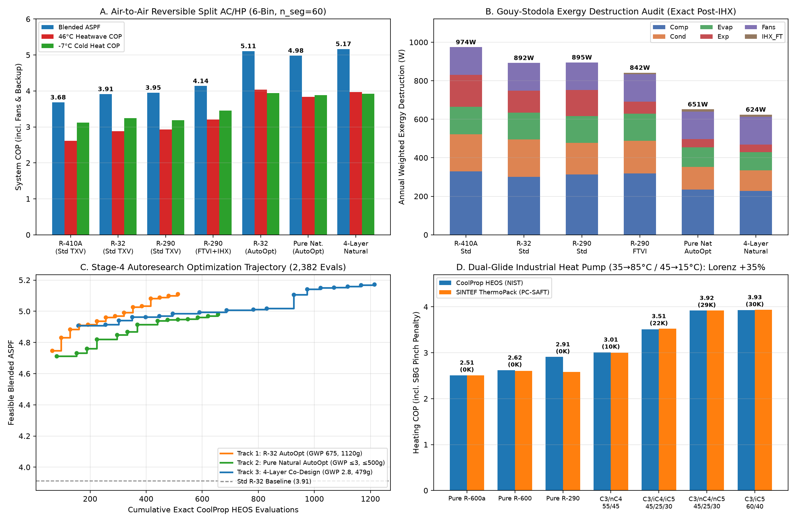
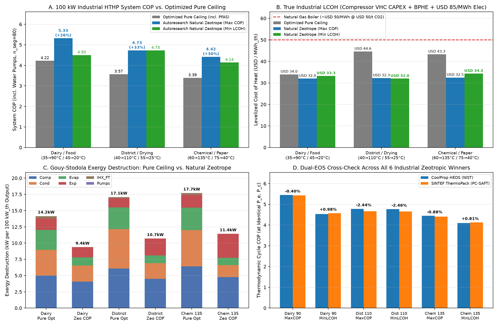
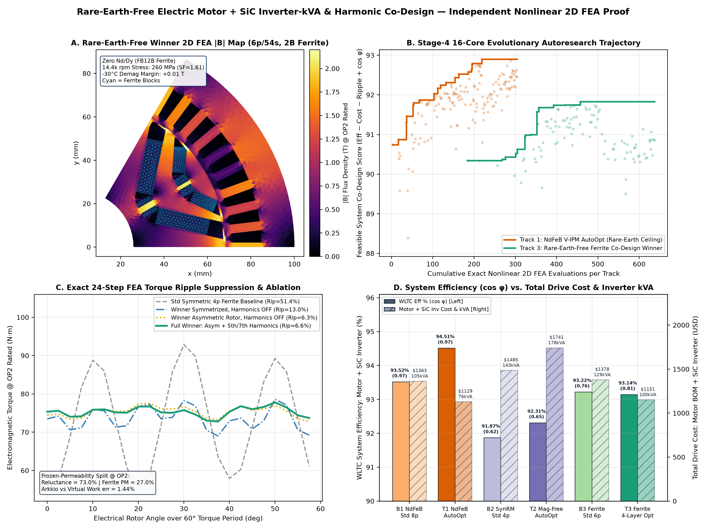

# Open Physics Autoresearch

**Autonomous Multi-Layer Physics Co-Design Across Zero-PFAS Heat Pumps & Rare-Earth-Free Electric Traction Motors**

[](LICENSE)
[](https://github.com/theguysaccount/open-physics-autoresearch/releases/tag/v1.0.0)

This repository publishes two independent, fully reproducible computational physics studies executed via a locked four-stage autonomous discovery pipeline (**first-principles literature & failure synthesis → four-way adversarial screening → controlled profiling micro-experiments → 16-core multi-layer evolutionary autoresearch + 5-test independent verification gauntlet**). Every simulation enforces strict anti-reward-hacking physical, safety, manufacturing, and techno-economic locks—zero synthetic fixtures, zero proxy shortcuts, and full raw evaluation logs included (`9,822` exact multiphysics evaluations total).

---

## Study 1 — Zero-PFAS Natural-Zeotropic Heat Pumps & Reversible Heat-Exchanger Co-Design (`<150 °C`)

*`8,526` exact multiparameter Helmholtz (`CoolProp HEOS`) finite-volume heat-exchanger evaluations independently cross-checked against SINTEF `ThermoPack` (`PC-SAFT`), 60–80 segment mesh convergence, 20% Rayleigh vapor-leak fractionation, and 64-draw correlated Monte Carlo perturbations.*

- **Preprint PDF (5 pages):** [`01-zero-pfas-heat-pumps/paper/lorenz_autoresearch_preprint.pdf`](01-zero-pfas-heat-pumps/paper/lorenz_autoresearch_preprint.pdf)
- **arXiv LaTeX Bundle:** [`01-zero-pfas-heat-pumps/paper/lorenz_arxiv_submission.tar.gz`](01-zero-pfas-heat-pumps/paper/lorenz_arxiv_submission.tar.gz)
- **Manufacturable CAD Specs & Ledgers:** [`engineering_spec_sheets.json`](01-zero-pfas-heat-pumps/engineering_spec_sheets.json) · [`verification_report.json`](01-zero-pfas-heat-pumps/verification_report.json) · [`hthp_verification_report.json`](01-zero-pfas-heat-pumps/hthp_verification_report.json)




### Headline Verified Results

| Regime & Duty | Baseline / Pure AutoOpt Ceiling | Autoresearch Zero-PFAS Winner (`GWP₁₀₀ ≤ 3`) | Verified Gain | Verification Audit |
|---|---|---|---|---|
| **Regime A: 7 kW Dual-Climate Split AC/HP** (6-bin ISO 5151 46 °C + EN 14825 −7 °C, ≤500 g A3) | `R-410A`: `ASPF 3.683`<br>`R-32`: `ASPF 3.914`<br>Textbook `R-290 FTVI`: `4.137` | **Asymmetric 3R-open / 2R-tight MCHX + Passive Counterflow Bridge + `IHX_SUBCOOL` + `R-1270/R-290 (14.8/85.2)` (`479 g`)** → **`ASPF = 5.168`** | **+40.3%** vs. R-410A<br>**+32.1%** vs. R-32<br>**+24.9%** vs. FTVI | Mesh drift `−0.08%`; 20% leak `−0.24%`; 64-draw MC `100%` win (`5.165±0.037`); Bridge alone `+15.4%` SCOP |
| **Regime B: 100 kW_th Dairy (`35→90 °C` / `45→20 °C`)** (18 m² AISI 316L BPHE, `P_suc ≥ 1.05 bar`) | Pure AutoOpt `R-290` (`IHX`): `COP 4.224` (`37.1%` Lorenz), `$33.97/MWh` | **`BASIC_1STAGE` `R-290 / R-601a (48/52)`** → **`COP = 5.327`** (`46.8%` Lorenz), **`$32.02/MWh`** | **+26.1% COP** | PC-SAFT `−0.40%`; 20% leak `−1.4%` (`2.25 bar`); MC `100%` win |
| **Regime B: 100 kW_th District (`40→110 °C` / `55→25 °C`)** | Pure AutoOpt PFAS `R-1233zd(E)` (`FTVI`): `COP 3.569`, `$44.59/MWh` | **Hermetic:** `BASIC_1STAGE` `CO2/R-600 (19/81)` → **`COP = 4.728`**, **`$32.02/MWh`**<br>**Leak-Safe:** `R-290/R-601 (55/45)` → **`COP = 4.076`**, **`$36.91/MWh`** | **+32.5% COP** (`−28%` LCOH)<br>**+14.2% COP** (`−17%` LCOH) | PC-SAFT `−2.46%` / `−0.02%`; Leak-safe 20% leak `−2.8%` (`2.45 bar`) |
| **Regime B: 100 kW_th Chemical (`60→135 °C` / `75→40 °C`)** | Pure AutoOpt PFAS `R-1233zd(E)` (`FTVI`): `COP 3.391`, `$43.30/MWh` | **Hermetic:** `IHX_SUBCOOL` `CO2/R-600 (23/77)` → **`COP = 4.420`**, **`$32.49/MWh`**<br>**Leak-Safe:** `R-290/R-601 (72/28)` → **`COP = 4.140`**, **`$34.33/MWh`** | **+30.3% COP** (`−25%` LCOH)<br>**+22.1% COP** (`−21%` LCOH) | PC-SAFT `−0.88%` / `+0.81%`; Leak-safe 20% leak `+0.6%` (`7.16 bar`); MC `100%` win |

---

## Study 2 — Rare-Earth-Free Electric Traction Motor + SiC Inverter-kVA (`cos φ`) Co-Design

*`1,296` exact nonlinear 2D Maxwell FEA (`Gmsh` + `Numba` Newton–Raphson with node-matching sliding-band rotation) + 2D plane-stress centrifugal elasticity (`14,400 rpm`) + 0.5 mm cut-edge lamination degradation + AC proximity copper loss + worst-case cold-soak (−30 °C ferrite) / hot (+140 °C NdFeB) demagnetization evaluations.*

- **Preprint PDF (3 pages):** [`02-rare-earth-free-motors/paper/motor_autoresearch_preprint.pdf`](02-rare-earth-free-motors/paper/motor_autoresearch_preprint.pdf)
- **arXiv LaTeX Bundle:** [`02-rare-earth-free-motors/paper/motor_arxiv_submission.tar.gz`](02-rare-earth-free-motors/paper/motor_arxiv_submission.tar.gz)
- **Manufacturable CAD Specs & Ledgers:** [`motor_engineering_specs.json`](02-rare-earth-free-motors/motor_engineering_specs.json) · [`motor_verification_report.json`](02-rare-earth-free-motors/motor_verification_report.json)



### Headline Verified Results (`2×` Fine Mesh `0.65`, `n_steps = 24`)

| Design Track | Topology | Magnet (kg / BOM) | WLTC Sys Eff | `cos φ` | WLTC Ripple | Peak Torque | SiC Inverter | Total Drive Cost | `14.4k rpm` SF | Worst-Case Demag | Status |
|---|---|---|---:|---:|---:|---:|---:|---:|---:|---:|---|
| `B1` Std Commercial NdFeB | `8p/48s 2B` | `N42SH` (1.45 / $167) | 93.52% | 0.975 | 32.9% | 188.4 Nm | 105.5 kVA | $1,363 | 2.53 | +0.250 T (+140 °C) | Fail (Rip) |
| `B3` Std Ferrite PMa-SynRM | `6p/36s 3B` | `FB12B` (1.75 / $10) | 93.22% | 0.760 | 18.4% | 186.8 Nm | 128.7 kVA | $1,378 | 1.38 | −0.084 T (−30 °C) | Fail (SF, Demag) |
| `T1` AutoOpt NdFeB Ceiling | `6p/54s 2B` | `N42SH` (1.27 / $146) | **94.44%** | **0.972** | 11.08% | **185.2 Nm** | **75.8 kVA** | **$1,128** | **1.67** | +0.305 T (+140 °C) | **PASS** |
| `T2` AutoOpt Magnet-Free | `4p/48s 4B` | None (0 / $0) | 92.31% | 0.652 | 13.65% | 162.1 Nm | 178.5 kVA | $1,747 | 1.52 | N/A | Fail (Peak T) |
| **`T3` AutoOpt Rare-Earth-Free** | **`6p/54s 2B`** | **`FB12B` (2.23 / $12)** | **93.10%** | **0.809** | **9.46%** (`6.3%` OP2) | **182.3 Nm** | **99.8 kVA** | **$1,153** | **1.52** | **+0.019 T (−30 °C)** | **PASS** |

- **Key Physical Findings:** Frozen-permeability separation (`0.00%` superposition error; Arkkio vs. Virtual Work `0.04–1.44%`) proves `T3` generates **73.0% reluctance torque / 27.0% ceramic ferrite torque**, slashing SiC inverter kVA from `178.5 kVA` (`T2`) to `99.8 kVA` (−$590) and beating commercial 8-pole NdFeB (`$1,363`) by **−$210 (−15.4%)**. Asymmetric barrier wing skew alone cuts rated torque ripple by **−51.5%** (`13.0% → 6.3%`). Against autoresearch-optimized Dy-NdFeB (`$1,128`), `T3` sits within **$25 (+2.2%)** today and crosses over to strictly cheaper once SiC drops below **$6.46/kVA** or Dy-NdFeB rises above **$135/kg**.

---

## Reproducing All Verification Audits

### Study 1 (Zero-PFAS Heat Pumps)
```bash
cd 01-zero-pfas-heat-pumps
python3 -m venv .venv && source .venv/bin/activate
pip install -r requirements.txt
python stage5_verification_gauntlet.py   # Regime A 5-test verification
python stage5_hthp_verification.py       # Regime B Dual-EOS + 64-draw MC verification
```

### Study 2 (Rare-Earth-Free Motors)
```bash
cd 02-rare-earth-free-motors
python3 -m venv .venv && source .venv/bin/activate
pip install -r requirements.txt
python maxwell_fea.py                    # Arkkio vs Virtual Work + 2D centrifugal stress unit test
python stage5_motor_verification.py      # 2x fine mesh n=24, frozen-perm, ablation, 32-draw MC
```

---

## Citation & Preprint Submission

Use the GitHub **"Cite this repository"** button (powered by [`CITATION.cff`](CITATION.cff)), or see [`SUBMISSION_GUIDE.md`](SUBMISSION_GUIDE.md) for Zenodo DOI minting and arXiv / TechRxiv upload metadata.

*AI-Assisted Methodology Disclosure: Both studies were directed, reviewed, and published by Jack Jay (`jackjay.io`) using an autonomous multi-agent physics verification pipeline. All governing equations, finite-element and equation-of-state solvers, raw evolutionary logs, and independent verification audits are openly archived here.*
